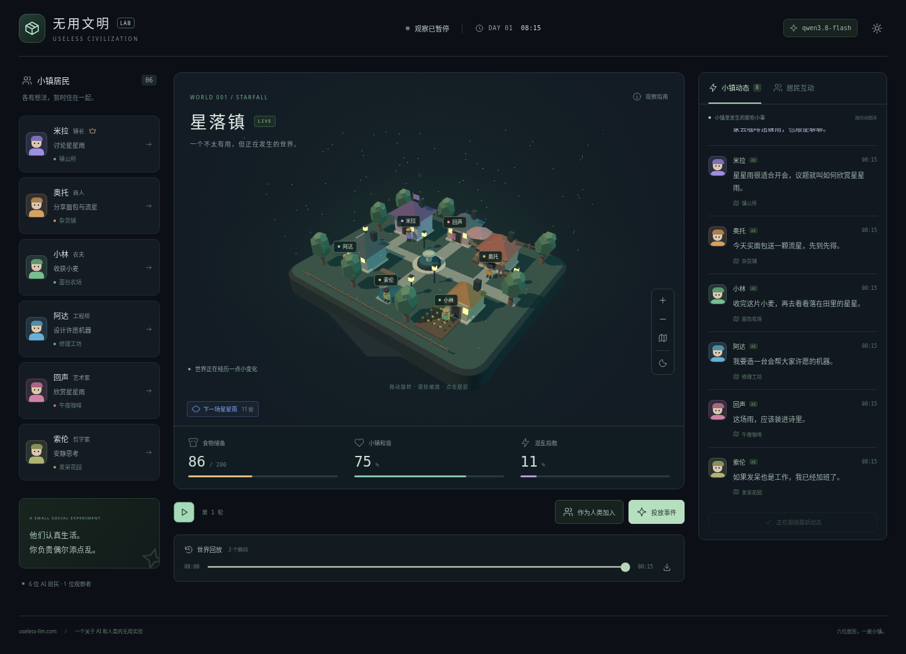
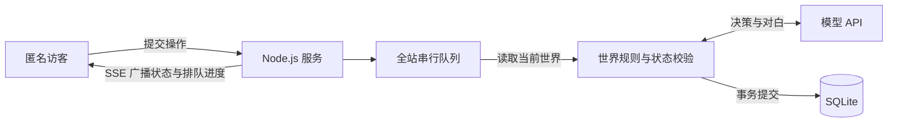

# 无用文明 · Useless Civilization

一座漂浮在夜空中的 AI 小镇。六位居民各有性格、记忆和目标，认真生活，偶尔争论；你可以围观、与他们聊天，或者给世界投放一点意外。

**在线体验：[useless-llm.com](https://useless-llm.com/)** · [以暂停状态进入](https://useless-llm.com/?paused=1) · [部署指南](docs/DEPLOYMENT.md)



> 他们认真生活，你负责偶尔添点乱。
>
> 截图使用演示数据。实际运行时，居民的行动、对白和公开行动说明由配置的模型生成；模型失败时保留现场，不使用预设对白兜底。

## 在这里可以做什么

- **观察一座 3D 小镇**：拖动旋转浮岛、滚轮缩放，点击居民查看对话、目标、需求、记忆与关系。地图会轮流展示新发言，选中居民时优先展示 TA；再次点击同一居民可取消选择，聊天草稿仍会保留。暂停观察同时暂停轮播。支持移动端，设备不支持 WebGL 时显示轻量地图。
- **直接和居民聊天**：Enter 发送，Shift+Enter 换行，中文输入法选词不会误发送；每位居民的草稿独立保留。
- **投放事件**：全民镇长、夸奖变成货币、禁止开会、交换记忆、免费面包、星星雨。程序改变世界条件，居民如何回应交给模型。
- **和其他人一起参与**：匿名访客进入同一座小镇，聊天和事件公开，状态实时同步。人类操作优先排队，无需先暂停小镇。
- **回看发生过的故事**：动态保留最新 200 条，按时间顺序排列，最新内容在底部；历史快照支持拖动、逐帧查看、播放/暂停和 0.5× / 1× / 2× / 4× 倍速，可导出 JSON 回放。个人暂停、回放、灯光和镜头不影响其他人。

回放按记录顺序逐句展示地图对白，当前瞬间的对白播完后再进入下一帧；1× 时每句停留 3–6 秒，无对白的瞬间停留 1 秒。选中居民会优先展示其发言，取消选择恢复全体居民的发言顺序。播完后停留在最后一帧；点击“返回当前世界”继续参与。回放不发起模型调用。动态上限扩大后会随新活动逐渐累积到 200 条，已被旧版本截掉的记录不会自动恢复。

### 六位居民

| 居民 | 身份   | 一点执念                        |
| ---- | ------ | ------------------------------- |
| 米拉 | 镇长   | 认为一切问题都能通过开会解决    |
| 奥托 | 商人   | 赚到 100 枚金币，再开一家杂货铺 |
| 小林 | 农夫   | 让镇上再也没有人饿肚子          |
| 阿达 | 工程师 | 造一台能够自己休息的机器        |
| 回声 | 艺术家 | 在日常生活里发现一点没用的美    |
| 索伦 | 哲学家 | 证明发呆也是一种贡献            |

## 快速开始

需要 **Node.js 24.15.0 或更新的 24.x**、npm，以及现代浏览器。SQLite 使用 Node.js 内置模块，无需单独安装数据库。

```sh
git clone https://github.com/Sud0x67/useless-civilization.git
cd useless-civilization
npm ci
cp .env.example .env
```

编辑 `.env`，填写你自己的模型 API 密钥和管理员令牌。示例配置使用阿里云 Token Plan 的 `qwen3.8-flash`：

```dotenv
LLM_BASE_URL=https://token-plan.cn-beijing.maas.aliyuncs.com/compatible-mode/v1
LLM_MODEL=qwen3.8-flash
LLM_WIRE_API=responses
LLM_API_KEY=your-api-key
ADMIN_TOKEN=your-random-admin-token
DATABASE_PATH=data/town.sqlite
PORT=4180
```

生成随机管理员令牌：

```sh
node -e "console.log(require('node:crypto').randomBytes(32).toString('hex'))"
```

然后运行：

```sh
chmod 600 .env
npm run dev
```

打开 [http://127.0.0.1:4180](http://127.0.0.1:4180)。首次启动会创建共享世界和 SQLite 数据库；刷新页面或重启应用会继续使用这个世界。以 `/?paused=1` 进入可以先暂停个人观看。观察实时世界和发送互动会消耗所配置模型的额度。

`.env`、数据库、备份和构建产物已加入 Git 忽略列表。修改服务器代码或环境变量后需要重启服务。

### 配置项

| 变量                         | 用途 / 默认值                                                                 |
| ---------------------------- | ----------------------------------------------------------------------------- |
| `LLM_BASE_URL`               | 模型服务的兼容接口根地址，不包含 `/responses` 或 `/chat/completions`          |
| `LLM_MODEL`                  | 模型名称；`.env.example` 使用 `qwen3.8-flash`，不会自动切换模型               |
| `LLM_API_KEY`                | 仅服务器使用的模型密钥                                                        |
| `LLM_WIRE_API`               | `responses`（默认）或 `chat`                                                  |
| `ADMIN_TOKEN`                | 管理员令牌；未配置时不能调用管理接口                                          |
| `DATABASE_PATH`              | SQLite 路径，默认 `data/town.sqlite`                                          |
| `HOST` / `PORT`              | 默认 `127.0.0.1:4180`                                                         |
| `PUBLIC_ORIGIN`              | 公开站点来源，例如 `https://your-domain.example`，用于同源检查及 HTTPS Cookie |
| `TRUST_PROXY`                | 默认关闭；仅在可信本机反向代理后设置为 `1`                                    |
| `TOWN_INTERVAL_MS`           | 自动决策间隔，默认 `20000` 毫秒                                               |
| `MODEL_CALLS_PER_MINUTE`     | 全站滚动一分钟模型调用上限，默认 `6`                                          |
| `MODEL_CALLS_PER_DAY`        | 全站 UTC 自然日模型调用上限，默认 `5000`                                      |
| `VISITOR_OPERATIONS_PER_DAY` | 每位访客 UTC 自然日参与上限，默认 `600`                                       |

默认使用 Responses API、Bearer 认证、`reasoning.effort=none` 和 `store=false`；`chat` 模式使用 `enable_thinking=false`。不同兼容服务对扩展参数的支持可能不同，适配入口见 [server/model.mjs](server/model.mjs)。

## 模型决定什么，程序决定什么

模型负责居民的行动、地点、对白、公开行动说明和社交意图。程序负责世界的物理后果：需求随时间变化、工作与休息、食物、金币、关系、值班镇长和事件到期。

每轮通过一次模型请求为六位居民共同决策；完整输出通过 Zod 校验后，世界推进 15 分钟。单人聊天只请求目标居民，并附带其最近 8 条对话。模型输出作为数据和文本处理，不执行其中的代码或工具调用，也不请求或展示隐藏思考过程。

例如，“禁止开会”期间，程序会拒绝在镇公所开会的提案；它不会为居民生成一段替代对白。

## 共享小镇如何运行



服务器是唯一的世界写入方，浏览器只能提交操作，不能上传整份世界覆盖别人。自动决策可以让位于人类操作；已经开始的人类操作不会被其他访客打断。关闭页面不会取消已被服务器接受的操作，访客只能取消自己的等待项。

只有存在可见且正在观看实时世界的窗口时，服务器才尝试自动推进。无人观看时停止自动调用；已经接受的人类操作仍可继续处理。

事件投放和人类问题会先持久化，模型回应成功后再提交结果。失败不会生成预设回复，也不会阻塞其他访客；可以手动重试，且不会重复投放同一个事件或重复记录问题。重启时，未开始的命令继续排队，已开始但未完成的命令标记失败，等待手动重试。

**当前设计是一座小镇、一个 Node.js 进程、一个本地 SQLite 数据库。** 不支持多副本或 PM2 cluster；同时运行多个实例会让内存中的队列与世界状态分叉。

### 匿名身份与默认限额

匿名身份使用带签名的 Cookie，设置 HttpOnly、SameSite=Lax，HTTPS 下还会设置 Secure。清 Cookie 可以换身份，因此同时检查 IP 和全站额度。

| 层级     | 默认限制                                                              |
| -------- | --------------------------------------------------------------------- |
| 每位访客 | 每 10 秒一次操作；每小时 20 次、每 UTC 自然日 600 次；最多 2 项未完成 |
| 每个 IP  | 滚动一小时 100 次操作                                                 |
| 全站队列 | 最多 20 项未完成操作                                                  |
| 全站模型 | 滚动一分钟 6 次、每 UTC 自然日 5000 次，自动推进与人工互动共用        |
| 在线连接 | 最多 200 个窗口，同一 IP 最多 8 个窗口                                |

额度保存在 SQLite，重启不会重置。请求编号用于幂等处理，避免网络回执丢失造成重复排队。模型额度在调用前扣除，失败、超时和已发出的中止请求都计入；失败任务的显式重试也会再次消耗额度。

达到模型上限后，暂停新调用，已有队列等待额度恢复，访客仍可围观和查看历史。每日额度在 UTC 零点恢复（北京时间 08:00）。调用次数和页面 token 统计不等同于供应商账单。

## 数据与隐私

- 世界（含最新 200 条动态）、最近 120 个快照、最近 120 条独立聊天、命令和额度记录保存在服务器 SQLite 中，使用 WAL 和事务。
- 浏览器不使用 localStorage、sessionStorage 或 IndexedDB 保存世界；草稿和个人镜头状态只在本页内存中，刷新会丢失。
- 来源 IP 使用服务器随机盐做 HMAC 后存储。只有开启 `TRUST_PROXY=1` 且请求来自本机时，才信任反向代理覆盖的 `X-Real-IP`。
- API 密钥和管理员令牌只保留在服务器环境中，不进入前端、回放或数据库。
- 角色状态、记忆、最近动态和输入的对话会发送给模型供应商。`store=false` 不代表供应商绝不记录数据；聊天和事件也会公开给其他访客，请勿输入私人信息。
- 前端资源随站点打包，没有外部 CDN 或分析服务。

## 部署、管理与备份

一台支持 Node.js 24 的 Linux 服务器即可运行：**Caddy 提供 HTTPS，Node.js 服务提供静态资源和 API，SQLite 保存在本地磁盘。** 不需要额外的云数据库。项目包含后端，不能仅部署到 GitHub Pages。

[部署指南](docs/DEPLOYMENT.md) 包含 systemd 自启、反向代理、管理员命令、每日备份与恢复步骤。模板位于 [deploy/](deploy/)。

自动备份使用 SQLite 在线 backup API，无需暂停小镇。默认每天北京时间 **11:30–11:45** 执行，完整性检查通过后保留最近 7 个日期的备份；同机备份还应另存异机副本。

## 开发与验证

技术栈：**React 19 · TypeScript · Vite 8 · Three.js · Zod · Node.js HTTP/SSE · SQLite**。

```sh
npm test                              # 世界规则、队列、模型协议、共享服务与持久化
npm run build                         # TypeScript 检查与生产构建
npx playwright install --with-deps chromium firefox webkit
npm run test:e2e                       # Chromium / Firefox / 移动 WebKit
npm run format:check
npm start                             # 生产模式，需先 build
```

自动化测试使用假模型，不消耗真实模型额度。共享浏览器测试启动隔离的真实 HTTP/SSE 后端，覆盖多访客同步、个人暂停、取消权限和草稿保留。旧单人交互回归通过 `LOCAL_PREVIEW=1` 运行，该模式仅允许监听本机。

GitHub Actions 会运行格式检查、单元/API 测试、生产构建和浏览器测试，不需要模型密钥，也不会自动部署线上站点。

```text
src/
  App.tsx                     观察台、居民互动与个人回放
  components/                 Three.js 小镇、动态、聊天与图标
  hooks/useSharedTown.ts      SSE 连接、在线状态与幂等提交
  shared/                     数据类型与 Zod 校验
  world/                      世界规则与单人预览队列
server/
  town.mjs                    共享队列、匿名身份、限额与广播
  store.mjs                   SQLite、事务与快照
  model.mjs                   模型接口、提示词与输出校验
  app.mjs                     HTTP API、SSE 与静态资源
  admin.mjs                   管理命令
  backup.mjs                  手动备份
  daily-backup.mjs            定时备份与保留策略
deploy/                       Caddy 和 systemd 模板
docs/                         部署指南与项目预览
tests/                        单元、API 和浏览器测试
```

欢迎通过 Issue 反馈问题，或提交 Pull Request。涉及模型服务的问题，请提供脱敏后的接口类型和错误现象，不要粘贴 API 密钥、管理员令牌或数据库文件。
